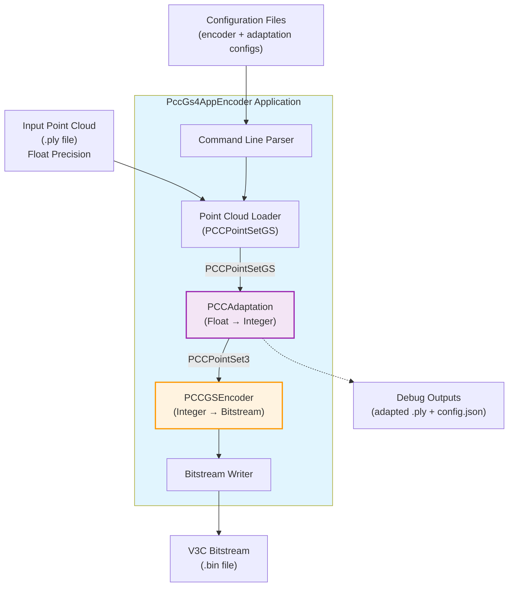
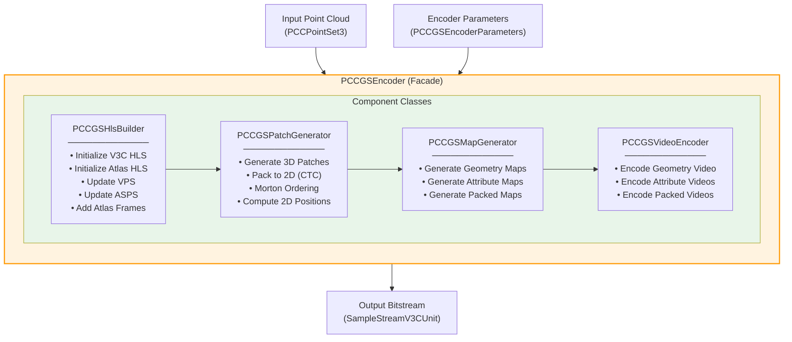
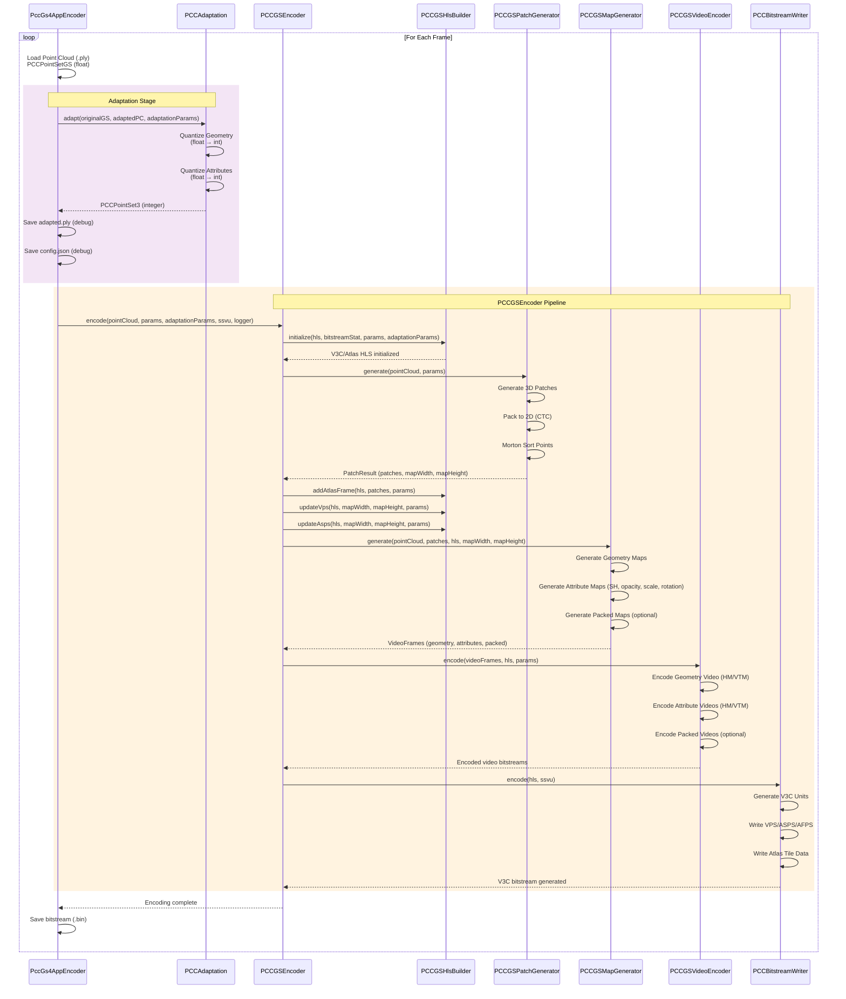
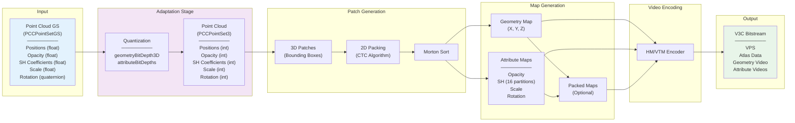
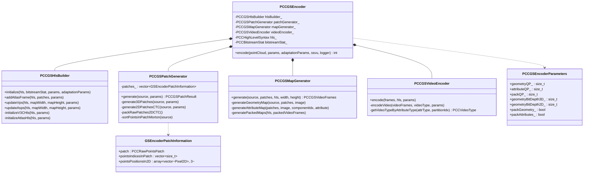

# PccGs4AppEncoder

## Overview

**PccGs4AppEncoder** is a Gaussian Splatting (GS) point cloud encoder application that is part of the MPEG Point Cloud Compression (PCC) Test Model 2 (TMC2) software. It encodes 3D Gaussian Splatting point clouds into V3C (Visual Volumetric Video-based Coding) bitstreams compliant with ISO/IEC 23090-5.

The encoder processes floating-point Gaussian Splatting point clouds (`PCCPointSetGS`) by first applying quantization and adaptation (`PCCAdaptation`) to convert them into integer-based point clouds (`PCCPointSet3`), which are then encoded using the main encoder pipeline (`PCCGSEncoder`).

## Features

- Encodes 3D Gaussian Splatting point clouds with associated attributes
- Supports geometry, opacity, spherical harmonics, scale, and rotation attributes
- Point cloud adaptation and quantization preprocessing (float → int conversion)
- Generates V3C compliant bitstreams
- Configurable video encoder settings for geometry and attributes
- Debug output support for adapted point clouds and configuration files

## Complete Encoding Pipeline

The encoding process consists of two main stages:

### Stage 1: Adaptation (Float → Integer)
The `PCCAdaptation` module converts floating-point Gaussian Splatting data into quantized integer representation:

1. **Input**: `PCCPointSetGS` (float precision)
   - Positions: 3D float coordinates
   - Opacity: float values
   - Spherical Harmonics: float coefficients (degree 0-3)
   - Scale: 3D float values
   - Rotation: quaternions (float)

2. **Adaptation Process**:
   - Quantize positions to integer coordinates based on `geometryBitDepth3D`
   - Quantize attributes to integer values based on attribute bit depths
   - Apply bounding box normalization
   - Store quantization parameters for decoder reconstruction

3. **Output**: `PCCPointSet3` (integer precision)
   - Quantized geometry and attributes ready for encoding

### Stage 2: Encoding (Integer → Bitstream)
The `PCCGSEncoder` encodes the adapted point cloud through the following steps:

1. **HLS Initialization**: Initialize V3C and Atlas high-level syntax structures
2. **Patch Generation**: Generate 3D patches and pack them into 2D layouts using CTC algorithm
3. **HLS Update**: Update VPS and ASPS with map dimensions from packing results
4. **Map Generation**: Create geometry and attribute 2D maps from patches
5. **Video Encoding**: Encode maps using HM/VTM video codecs
6. **Bitstream Writing**: Generate final V3C bitstream with all syntax elements

## Application Architecture



## PCCGSEncoder Component Architecture

The encoder follows the **Facade design pattern**, orchestrating four specialized component classes:



## Encoding Pipeline Flow



## Data Flow Diagram



## Class Diagram



## Usage

```bash
./bin/PccGs4AppEncoder \
	--uncompressedDataPath=/path/to/ply_file.ply \
   	--configurationFolder=./mpeg-pcc-tmc2/cfg/gs4/ \
	--config=./mpeg-pcc-tmc2/cfg/gs4/hm-main10/gs-main10-common.cfg \
	--config=./mpeg-pcc-tmc2/cfg/gs4/gs-pack-none.cfg \
	--config=./mpeg-pcc-tmc2/cfg/gs4/hm-main10/rate/r04.cfg \
	--compressedStreamPath=/path/to/compressed_file.v3c \
```

### Key Parameters

| Parameter | Description |
|-----------|-------------|
| `--uncompressedDataPath` | Path template for input point cloud files |
| `--compressedStreamPath` | Output V3C bitstream file path |
| `--configurationFolder` | Folder containing encoder configuration files |
| `--geometryConfig` | Geometry video encoder configuration file |
| `--attributeConfig` | Attribute video encoder configuration file |
| `--packConfig` | Packed video encoder configuration file |
| `--geometryQP` | Quantization parameter for geometry (default: 6) |
| `--attributeQP` | Quantization parameter for attributes (default: 6) |
| `--packQP_ ` | Quantization parameter for pack (default: 6) |

## Dependencies

- **PccLibGSEncoder**: Core GS encoding library
- **PccLibCommon**: Common utilities and data structures
- **PccLibBitstreamWriter**: V3C bitstream generation
- **PccLibAdaptation**: Point cloud preprocessing
- **HM/VTM**: HEVC/VVC video encoder for map encoding

## File Structure

```
source/app/PccGs4AppEncoder/
├── PccGs4AppEncoder.cpp      # Main application entry point
├── PCCGs4AppEncoderParams.h  # Application parameter handling
├── CMakeLists.txt           # Build configuration
└── README.md                # This file

source/lib/PccLibGSEncoder/
├── include/
│   ├── PccGSEncoder.h           # Main encoder facade
│   ├── PccGSEncoderParameters.h # Encoder parameters
│   ├── PCCGSPatchInfo.h         # Patch data structures
│   ├── PCCGSHlsBuilder.h        # HLS builder component
│   ├── PCCGSPatchGenerator.h    # Patch generator component
│   ├── PCCGSMapGenerator.h      # Map generator component
│   └── PCCGSVideoEncoder.h      # Video encoder component
└── source/
    ├── PccGSEncoder.cpp
    ├── PCCGSHlsBuilder.cpp
    ├── PCCGSPatchGenerator.cpp
    ├── PCCGSMapGenerator.cpp
    └── PCCGSVideoEncoder.cpp
```

## Build

```bash
# From the project root directory
./build.sh

# The executable will be in bin/PccGs4AppEncoder
```

